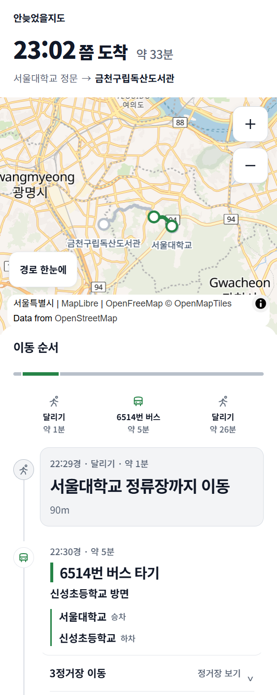
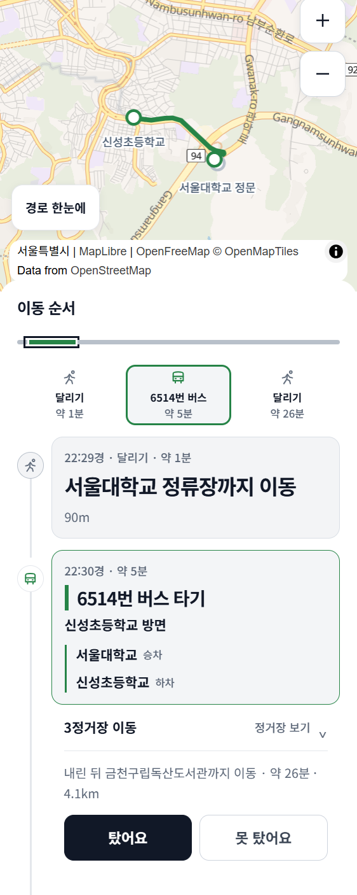

# 조준혁 | 문제의 목적을 구현과 검증으로 연결합니다

**삼일PwC AX인재전쟁 지원 포트폴리오 · 2026.11.15**

언어와 철학을 공부하며, 언어로 정리된 정보가 현실을 완전히 담을 수는 없다는 점을 배웠습니다. AI를 활용하면서도 충분한 컨텍스트가 곧 완전한 정보나 올바른 판단을 뜻하지는 않는다는 것을 경험했습니다. 그래서 업무의 목적에 비추어 전제를 점검하고, 빠진 조건과 예외를 찾는 데 집중합니다.

이 포트폴리오는 **문제 정의 → AI를 활용한 구현 → 결과의 모순 발견 → 검증 기준 수정**이라는 제 작업 방식을 두 프로젝트로 설명합니다. 제 역할은 목표·요구사항·판단 기준 설정, 결과 검토와 개선 방향 결정이며 코드 작성·디버깅·검증에는 AI 코딩 도구를 활용했습니다.

## 3분 검토 경로

1. **[포트폴리오 PDF](조준혁_포트폴리오.pdf)** — 소개, 주요 판단, 실제 화면, 구현 범위를 4쪽으로 정리했습니다.
2. **[안늦었을지도 사례](projects/deadline-router.md)** — 빠르게 뛰는데 늦게 도착한 원인, 선택 기준 수정, 상태·복구 설계.
3. **[실행 가능한 핵심 코드](code/README.md)** — 원 구현의 여정 서비스·SQLite 저장소와 네트워크 없는 검토용 검사.
4. **[우연한 식탁](projects/siktak.md)** — 운영 흐름·예외 처리와 공개 전체 코드 연결.

로그인 없이 문서·PDF·화면·코드를 볼 수 있습니다. 현재 교통 API나 별도 서비스 계정 없이 핵심 상태 처리 검사를 실행할 수 있습니다.

## 01. 안늦었을지도

**늦은 사람이 달리기와 대중교통을 결합해, 지금 출발할 빠른 길을 찾는 서비스입니다.**

가장 중요한 질문은 경로가 반환되는지가 아니라, 사용자가 더 일찍 도착하도록 선택했는지였습니다. 달리기 속도를 높였는데 도착이 늦어지는 결과를 발견한 뒤, 앞의 후보부터 잘라 내던 처리를 점검했습니다. 절대 도착시각으로 정렬한 뒤 결과 수를 제한하도록 고쳤고, 같은 저장 자료로 수정 전후를 대조했습니다.

또한 시간이 흘렀다는 이유로 탑승했다고 간주하지 않고, `탔어요 / 못 탔어요 / 내렸어요 / 도착했어요`라는 명시적 입력으로 여정을 진행합니다. 다시 연결했을 때는 저장된 상태를 복원하고, 새 교통 조회와 구분합니다.

<p>
  
  
</p>

*2026-10-28 실제 제품 UI 캡처. 과거 저장 경로를 표시한 화면이며 현재 교통이나 실제 이동 성공을 뜻하지 않습니다. 지도 출처 표기는 원본 그대로 보존했습니다.*

- 구성: Python 경로 API, MOTIS/Nigiri 경로 엔진, JavaScript MCP 앱, MapLibre 지도, 여정 상태 저장.
- 핵심 판단: 도착시각 우선 선택, 명시적 상태 전환, 중복 처리 방지, 실패 시 기존 안내 보존.
- [사례와 구조](projects/deadline-router.md) · [검증 범위](evidence/verification.md) · [기존 제품 소개 슬라이드](assets/deadline-router-introduction.pdf)

## 02. 우연한 식탁

**4~6명 저녁 모임의 신청부터 매칭·안내·체크인·후기까지 연결한 운영 MVP입니다.**

날짜·지역·인원·차단·비선호 같은 필수 조건과 선호 점수를 구분하고, 매칭 실패 시 대안 일정·이용권 보관·모의 환불로 이어지게 구성했습니다. 운영자는 예외 대시보드와 작업 큐를 통해 개입합니다.

- Next.js · React · TypeScript · PostgreSQL · Prisma · HiGHS
- [공개 전체 코드와 README](https://github.com/gurwnswh9910-maker/siktakpublic)
- [요구사항별 검토 경로](https://github.com/gurwnswh9910-maker/siktakpublic/blob/main/PRD-VERIFICATION.md)
- 범위: 결제·환불 및 식당 배정은 모의입니다. 실제 PG·식당 예약·실기기 푸시 수신을 완료했다고 제시하지 않습니다.

## 근거를 읽는 기준

| 자료 | 무엇을 확인할 수 있는가 |
|---|---|
| 공개 코드 검사 | 현재 공개한 여정 서비스의 상태 전환·DB 복원·중복/동시 요청·실패 처리. 교통 응답은 합성 입력 |
| 2026-09-06 기록 | 같은 저장 교통 자료에서 6구간×2속도, 12건 정상 반환. 실제 주행 결과 아님 |
| 2026-10-28 기록 | MCP·DB·브라우저 검사와 당시 배포 관측. 오늘의 운영 상태를 새로 확인한 결과 아님 |
| 제품 화면 | 실제 UI의 과거 저장 경로 표시. 시안이나 현재 교통 조회 결과로 바꾸어 제시하지 않음 |

현재 휴대폰 GPS 이동, 실제 미탑승 후 복구, 실제 도착시간 정확도 및 지각 감소는 확인하지 않았습니다. 이 저장소는 심사용 사례·화면·핵심 코드 패키지이며 안늦었을지도 전체 교통 서버의 배포 패키지는 아닙니다.

## 자료 구성

```text
조준혁_포트폴리오.pdf       4쪽 요약
projects/                 문제 해결 사례
code/                     원 구현 핵심 코드와 검토용 검사
evidence/                 검증 범위·기록·출처와 파일 해시
assets/                   실제 화면·기존 소개 슬라이드
```
