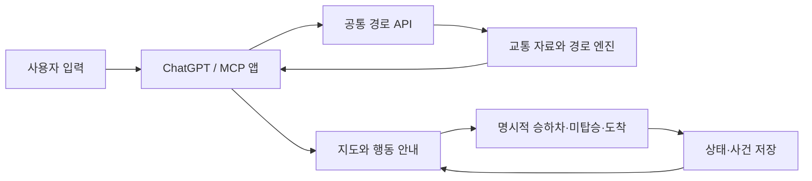
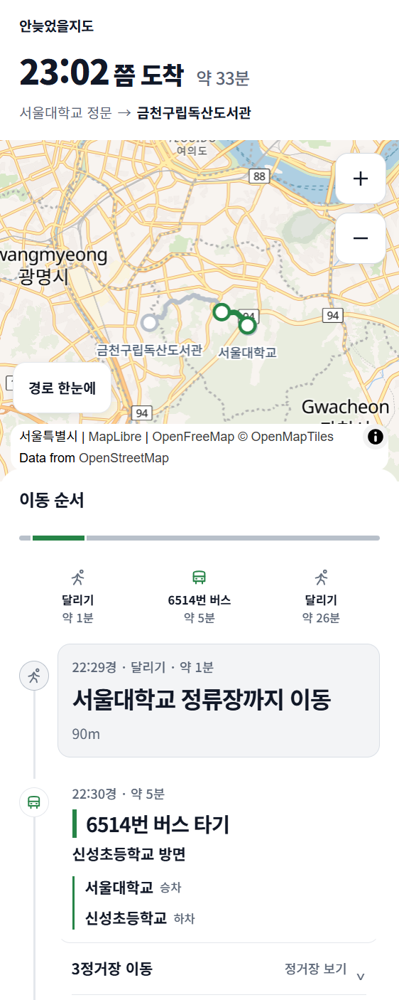

# 안늦었을지도 | 목적과 결과가 어긋나는 지점을 찾다

[포트폴리오 첫 화면으로](../README.md)

## 문제와 제 역할

일반적인 도보 연결 대신 사용자가 달릴 수 있는 속도를 반영하면 탈 수 있는 교통편과 유리한 환승 경로가 달라집니다. 목표를 '지금 출발해 더 일찍 도착할 경로 하나를 안내한다'로 정의했습니다. AI와 함께 경로 API·엔진·지도 UI를 구현하면서, 저는 결과가 이 목적에 맞는지 질문하고 선택·검증 기준을 수정했습니다.

## 사례 1. 더 빨리 뛰는데 도착이 늦어졌다

### 발견

동일한 저장 교통 자료로 속도를 비교하던 중, 경로를 찾지 못한 경우와 속도를 높였는데 도착이 늦어지는 결과가 있었습니다. 실행 성공 여부만으로는 이 모순을 잡을 수 없었습니다.

### 판단과 수정

엔진의 후보 순서는 반드시 절대 도착시각 순서가 아니었습니다. 앞의 후보부터 결과 수를 제한하면 뒤에 있는 더 이른 도착 후보를 버릴 수 있습니다. 후보를 **절대 도착시각 → 동률일 때 환승 수**로 정렬한 뒤 결과 개수를 제한하도록 수정했습니다. 기존 승차·실시간 결합 검증은 유지했습니다.

```text
기존: 경로 후보 → 앞의 N개 선택 → 반환
수정: 경로 후보 → 절대 도착시각 정렬 → 앞의 N개 선택 → 반환
```

### 당시 검증 결과 (2026-09-06)

동일 출발 기준시각 `2026-09-06T14:55:38+09:00`의 저장 자료를 재생했습니다. 새 외부 교통 수집 없이 비교했으며, 6구간×2속도 12건이 정상 반환됐습니다. 기존 경로 없음 2건이 정상화됐고, 이 6구간에서는 15km/h 설정이 10km/h보다 빠르게 도착했습니다.

| 구간 | 10km/h 소요(초) | 15km/h 소요(초) |
|---|---:|---:|
| aT센터 → 망원시장 | 3142 | 3082 |
| 국민대 → 이대목동병원 | 3922 | 3022 |
| 은평한옥마을 → 강동경희대병원 | 3922 | 3562 |
| 북서울미술관 → 마포아트센터 | 2842 | 2722 |
| 강북문화예술회관 → 목동운동장 | 3682 | 3502 |
| 강서구청 → 중랑구청 | 4102 | 3862 |

[표 데이터](../evidence/earliest-arrival-replay.csv). 당시 관련 검사 기록은 76 passed, 6 subtests passed입니다. 이 기록을 오늘 다시 전체 실행한 것은 아닙니다. 후보 수집의 완전성, 모든 경로의 최적성, 실제 이동시간 절감의 증거로 확대하지 않습니다.

## 사례 2. 계산된 예상과 실제 행동을 구분하다

처음 안내한 도착 예상, 새로 확인한 교통 관측, 사용자의 실제 행동을 하나의 상태로 섞으면 탑승하지 않은 사용자를 탑승 처리하거나 오래된 정보를 현재 정보로 보이게 할 수 있습니다.

- **명시적 진행:** 탔어요 → 내렸어요 → 다음 교통편/도착. 시간·GPS만으로 승차를 확정하지 않습니다.
- **미탑승 복구:** 현재 위치를 확인한 뒤 남은 경로를 다시 찾습니다. 실패하면 기존 안내를 보존합니다.
- **복원과 조회 분리:** 재접속은 DB 상태 복원입니다. 복원 자체로 교통 API를 재호출하지 않습니다.
- **중복·동시 요청:** 사건 식별자로 중복 처리를 막고, 버전 검사와 작업 잠금으로 충돌을 다룹니다.
- **측정 의미 보존:** 최초 목표시각·도착 예상을 보존합니다. 도착 버튼은 사용자의 신고이며 물리적 도착 증명은 아닙니다.

## 구조



이 공개 패키지에서는 [여정 서비스와 SQLite 저장소](../code/README.md)를 원 구현 그대로 제공하고, 합성 경로·교통 응답으로 직접 검사할 수 있게 했습니다. 운영 환경에서는 공유 저장소를 사용한 별도 구현·배포 기록이 있으나 운영 설정이나 접근 정보를 이 패키지에 담지 않았습니다.

## 화면과 검증 범위



2026-10-28 저장 경로 기반 실제 UI 캡처입니다. 전체 저장 응답의 해시, 화면 출처, 이번 공개 코드의 검사 결과는 [검증 기록](../evidence/verification.md)과 [출처 목록](../evidence/source-manifest.json)에 구분했습니다.

실제 GPS 이동·실제 미탑승 복구·휴대폰 앱 재진입·도착시간 정확도는 실사용 확인이 남아 있습니다. 현재 시간표의 유효성이나 서비스 운영 상태를 이번 공개 준비에서 새로 확인하지 않았습니다.
